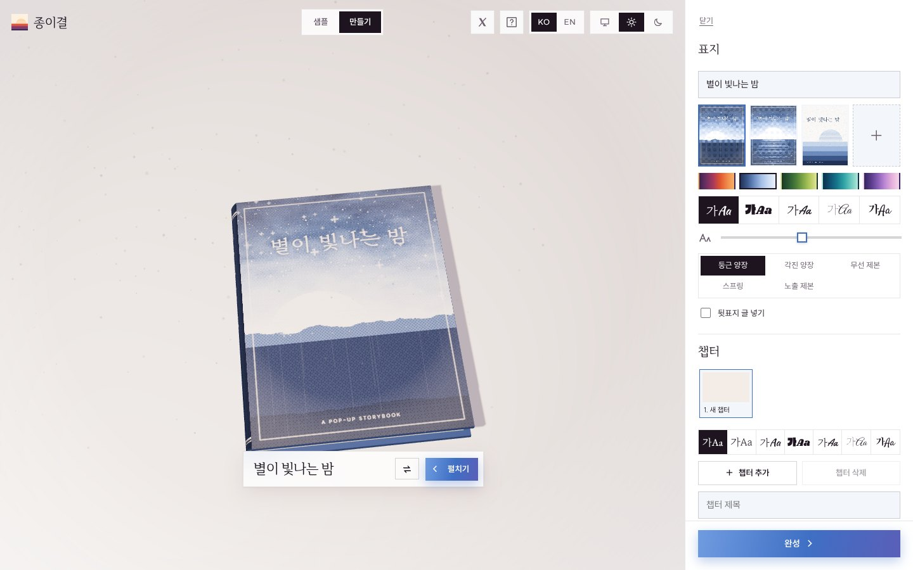
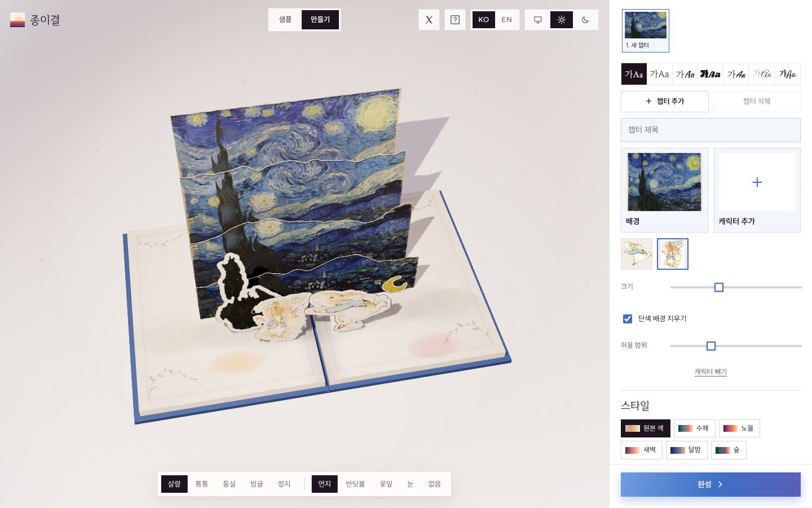
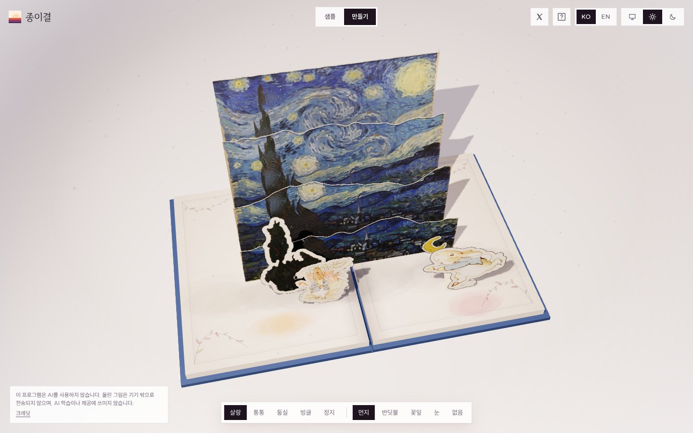
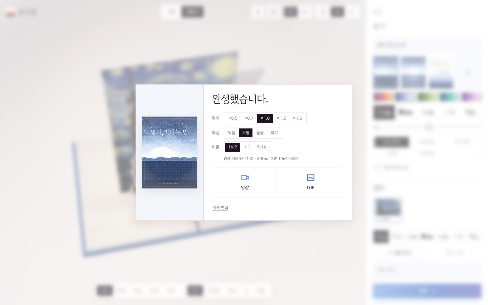

<div align="center">


# 종이결 · Papergrain
**AI 없이 그림 두 장으로 만드는 3D 팝업북**<br>
**POP-UP Book Generator** WITHOUT AI

**https://yoo0803.github.io/papergrain/**

AI 미사용 · 서버 없음 · 기기 안에서만 처리 · MIT
No AI · No server · Everything stays on your device · MIT

[영상]

</div>

## 핵심 · Highlights

| | |
|---|---|
| **배경 → 종이 무대**<br>**Background → paper stage** | 수채·잉크·종이결 스타일화, 윤곽 따라 겹 분리<br>Watercolor, ink and paper-grain styling, split into layers along the outlines |
| **물체 자동 오리기**<br>**Automatic object cut-outs** | 색·경계로 물체 분할 → 객체화, 드래그로 이동<br>Objects found by color and edges, cut out as pieces you can drag |
| **캐릭터 그대로**<br>**Characters as-is** | 입력 픽셀 무가공, 칼선 테두리만 추가<br>Original pixels untouched; only a die-cut outline is added |
| **캐릭터 여럿**<br>**Multiple characters** | 한 장에 최대 4명, 각각 드래그·크기·배경 제거<br>Up to 4 per page, each with its own drag, size and background removal |
| **진짜 책처럼**<br>**Like a real book** | 표지·책장 드래그 넘김, 펼친 만큼 솟는 팝업<br>Drag to open the cover and turn pages; the pop-up rises as the book opens |
| **모션·분위기**<br>**Motion & Ambience** | 캐릭터 모션 5종, 입자 5종 (먼지·반딧불·꽃잎·눈)<br>5 character motions, 5 particle options (dust, fireflies, petals, snow) |
| **표지**<br>**Cover** | 템플릿 4종, 색 테마 5종(책장·사이트 톤도 함께), 글꼴 5종, 제목 크기, 펼친 표지 한 장(뒷표지–책등–앞표지)<br>4 templates, 5 color themes (pages and site tone follow), 5 fonts, title size, one wrap-around image (back–spine–front) |
| **제본·뒷표지**<br>**Binding & Back Cover** | 둥근 양장·각진 양장·무선·스프링·노출 제본, 뒷표지 소개글·지은이·만든 날(선택), 챕터 제목 글꼴<br>Rounded hardcover, square hardcover, paperback, spiral, exposed spine; optional back-cover blurb, author and date; chapter title fonts |
| **완성**<br>**Finish** | 영상(MP4)·GIF 저장 — 길이 ×0.5~×1.5, 화질 4단계(최대 4K·60fps), 비율 16:9·1:1·9:16, 챕터 제목 포함<br>Save as video (MP4) or GIF — length ×0.5–×1.5, 4 quality levels (up to 4K 60fps), 16:9 · 1:1 · 9:16, chapter titles included |
| **기타**<br>**etc** | 한/영, 기기 설정·라이트·다크, 첫 방문 튜토리얼<br>Korean/English, system, light or dark mode, first-visit tutorial |

## 만드는 과정 · How it works

<table>
<tr>
<td width="50%" valign="top"><br><b>① 표지 꾸미기</b> · Design the cover<br><sub>제목 입력 · 템플릿 · 색 테마 · 글꼴 · 제본<br>Title, template, color theme, font, binding</sub></td>
<td width="50%" valign="top"><br><b>② 그림 넣기</b> · Drop in pictures<br><sub>배경 1장 + 캐릭터 최대 4명, 단색 배경 지우기<br>One background + up to 4 characters, solid-background removal</sub></td>
</tr>
<tr>
<td width="50%" valign="top"><br><b>③ 팝업북 완성</b> · Your pop-up book<br><sub>종이 겹 · 물체 오리기 자동, 캐릭터 드래그 · 모션 · 분위기 효과<br>Automatic layers and cut-outs; drag characters, add motion and ambience</sub></td>
<td width="50%" valign="top"><br><b>④ 영상·GIF 저장</b> · Save video / GIF<br><sub>길이 · 화질 · 비율 고르고 기기에 바로 저장<br>Pick length, quality and ratio, then save straight to your device</sub></td>
</tr>
</table>

## 개인정보 · Privacy

- 이미지 처리 전부 브라우저 안 (Canvas·WebGL)<br>All image processing happens in your browser (Canvas, WebGL)
- AI 모델·외부 API·분석 도구 없음<br>No AI models, external APIs or analytics
- 영상·GIF도 기기 안에서 만들어 바로 저장, 업로드 없음<br>Videos and GIFs are made on your device and saved directly, with no uploads

## 샘플 작품 · Sample artworks

**저작권이 만료된 퍼블릭 도메인 명화만 사용.**<br>
**Only public-domain masterpieces whose copyright has expired.**

Van Gogh, Monet, Beatrix Potter, 정선 Jeong Seon, 김홍도 Kim Hong-do, 조선 궁중화·민화 Joseon court & folk painting — [samples/CREDITS.md](samples/CREDITS.md)

## 실행 · Run locally

```sh
python3 -m http.server 8000   # → http://localhost:8000
```

ES 모듈 → `file://` 직접 열기 불가.<br>
Uses ES modules, so it can't be opened directly via `file://`.

## 배포 · Deploy (GitHub Pages)

1. 폴더를 저장소에 업로드<br>Upload the folder to a repository
2. `js/config.js` → `GITHUB_URL`에 저장소 주소<br>Set `GITHUB_URL` in `js/config.js` to your repository URL
3. Settings → Pages → `main` / `(root)` → Enforce HTTPS

## 구조 · Structure

```
index.html        마크업, CSP                                   Markup, CSP
css/              토큰·테마·컴포넌트, @font-face                Tokens, themes, components, @font-face
js/main.js        상태, 모드, UI                                State, modes, UI
js/book.js        three.js 책, 제스처, 팝업                     three.js book, gestures, pop-ups
js/stylize.js     배경 스타일화, 겹 분리, 캐릭터 카드           Background styling, layers, character cards
js/segment.js     물체 분할·오리기·빈자리 메우기                Object segmentation, cut-outs, gap filling
js/covers.js      표지 템플릿·테마·글꼴                         Cover templates, themes, fonts
js/export.js      영상·GIF (프레임 단위 렌더, 길이·화질·비율)   Video & GIF (frame-by-frame, length, quality, ratio)
js/safeimage.js   입력 이미지 검증                              Input image validation
js/pipeline.js    배경 처리 (스타일화·물체·겹) 단계별 캐시      Background processing, per-stage cache
js/worker.js      배경 처리를 백그라운드에서 실행               Runs background processing in a worker
vendor/           three.js r170, gifenc, mp4-muxer
fonts/            OFL·Apache 글꼴 (fonts/NOTICE.md)             OFL & Apache fonts
samples/          퍼블릭 도메인 이미지                          Public-domain images
```

## 크레딧 · Credits

- MIT © 2026 Y.C. — [LICENSE](LICENSE)
- 파비콘·표지 샘플 이미지: Claude Code<br>Favicon and sample cover images: Claude Code
- 글꼴·라이브러리·작품 전체 목록: [CREDITS.md](CREDITS.md)<br>Full list of fonts, libraries and artworks: [CREDITS.md](CREDITS.md)
